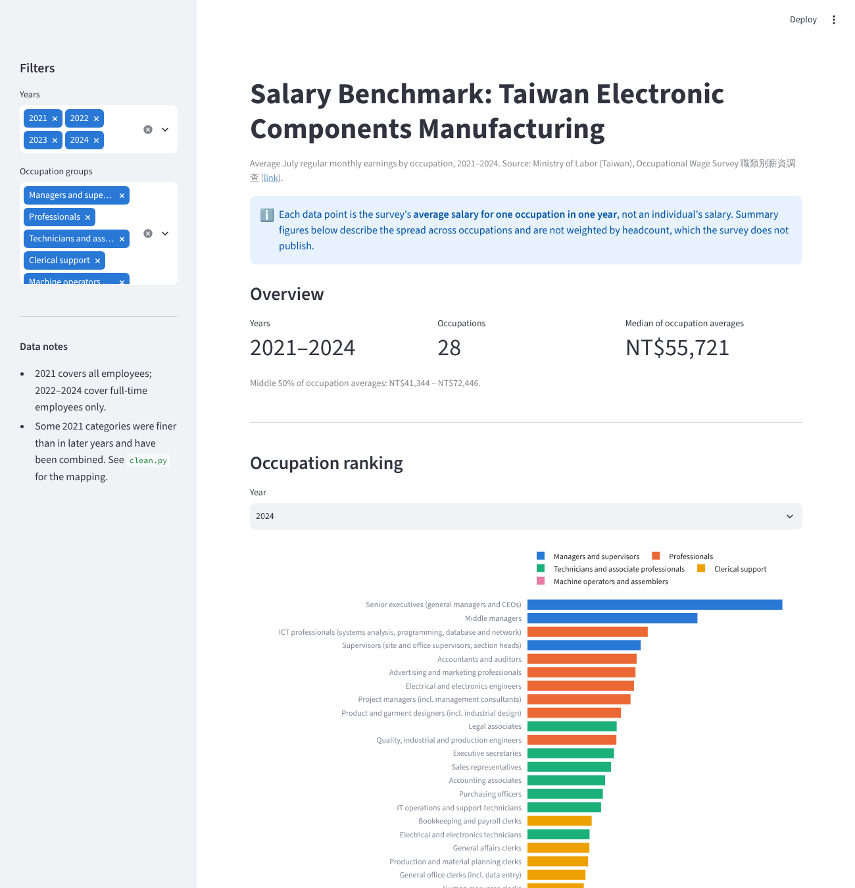

# Taiwan Salary Benchmark

An interactive salary benchmark for 28 occupations in Taiwan's electronic components manufacturing industry, built from the Ministry of Labor's Occupational Wage Survey for 2021 to 2024.

**Live app:** https://taiwan-salary.streamlit.app



## Why I built it

I built this during an internship to support a review of an employer's salary structure. The HR director needed an external benchmark for each role, so the company's pay could be compared with the industry by occupation. This repository contains only the public benchmark data. No company salary data is included.

## What the app shows

- A ranking of occupations by average monthly salary for a chosen year, coloured by occupation group
- The spread of occupation averages within each group
- Year-on-year change for up to six chosen occupations
- A comparison of advertised salaries from a small sample of job ads with the survey average
- The filtered data as a table, with a CSV download

## Data

| File | Contents |
| --- | --- |
| `data/raw/電子零件製造業{110-113}年7月經常性薪資.xlsx` | Raw survey extracts, one per year (ROC years 110 to 113 are 2021 to 2024) |
| `data/raw/job_ads_104.csv` | 15 job ads collected manually from 104, Taiwan's largest job board, for three occupations. Company names removed |
| `data/processed/salary_benchmark.csv` | The cleaned table the app reads, produced by `clean.py` |

The measure is **regular monthly earnings in July** (經常性薪資) in New Taiwan dollars. It excludes overtime pay and irregular bonuses.

## Method

`clean.py` turns the four raw files into one consistent table.

1. **Parse.** Each raw file lists occupations as `(code)name` with indentation for sub-groups. The script extracts the 6-digit code, the name and the salary.
2. **Handle suppressed values.** The survey shows `-` or `---` where a sample is too small to publish. These are treated as missing, and the script stops if any benchmark occupation is missing.
3. **Harmonise categories.** The 2022 to 2024 surveys use the same 28 categories. The 2021 survey split several of them more finely, so those are combined to match the later years:

   | Benchmark occupation | 2021 categories combined |
   | --- | --- |
   | Quality, industrial and production engineers | QC engineers; industrial and production engineers |
   | Electrical and electronics engineers | Electrical engineers; electronics engineers |
   | ICT professionals | Systems analysts; software developers; database and network professionals |
   | Electrical and electronics technicians | Electrical technicians; electronics technicians |
   | Quality, industrial and production technicians | QC technicians; industrial and production technicians |
   | General office clerks | General office clerks; data entry clerks |
   | Receptionists and information desk clerks | Receptionists; switchboard operators |
   | Production machine operators | Plastic product machine operators; packaging machine operators |
   | Semiconductor production line operators | Semiconductor machine operators (renamed) |

   Combined values use a simple mean, rounded down to the whole dollar.

4. **Label.** Each row gets an English name, an occupation group and the survey population for that year.

To rebuild the processed data and run the app:

```bash
pip install -r requirements.txt
python clean.py
streamlit run app.py
```

## Limitations

- **Survey population changed in 2022.** The 2021 survey covers all employees. From 2022 it covers full-time employees only, so part of any change between 2021 and 2022 comes from the definition rather than from pay. The app marks this break on the trend chart.
- **Unweighted means.** The survey does not publish headcounts, so combined 2021 categories use a simple mean rather than a mean weighted by the number of employees.
- **Approximate 2021 mapping for machine operators.** The 2021 survey has no single category for production machine operators. The two categories used are the closest available, but the 2021 figure for this occupation is less comparable than the others.
- **Summary figures describe occupations, not people.** Medians and ranges in the app are taken across occupation averages, so a small occupation counts as much as a large one.
- **The job ad sample is small and skews junior.** Most ads are for entry-level or junior roles, so advertised pay is expected to sit below the survey average for all employees in the occupation.

## Tech

Python, pandas, Plotly, Streamlit
